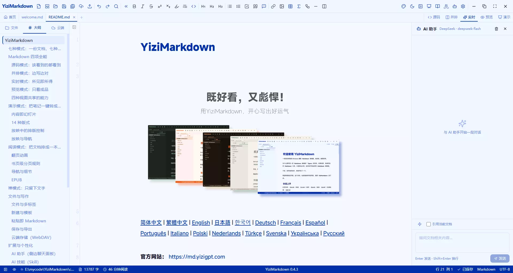
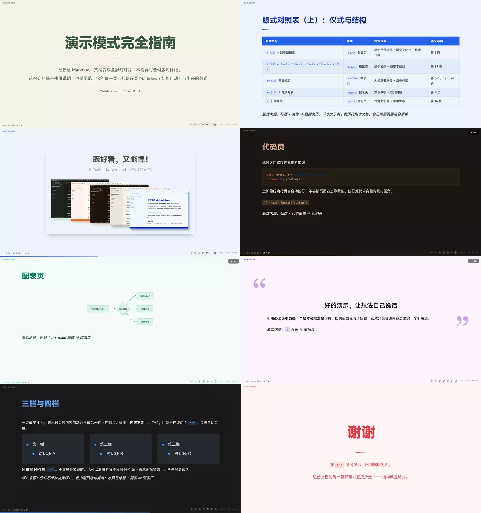
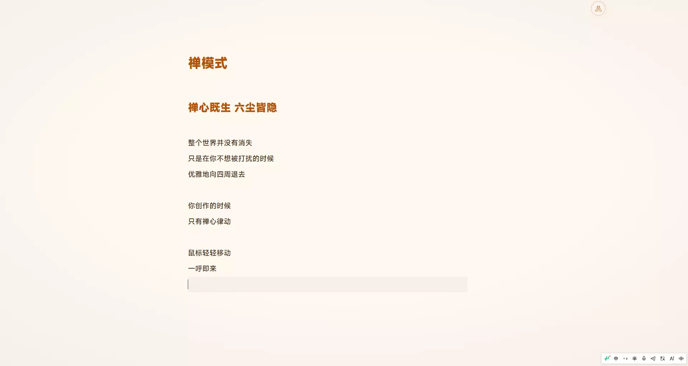

# YiziMarkdown


[简体中文](../../readme.md) | [繁體中文](./readme-zh-TW.md) | [English](./readme-en.md) | [日本語](./readme-ja.md) | [한국어](./readme-ko.md) | [Deutsch](./readme-de.md) | [Français](./readme-fr.md) | [Español](./readme-es.md) | [Português](./readme-pt.md) | [Italiano](./readme-it.md) | [Polski](./readme-pl.md) | [Nederlands](./readme-nl.md) | [Türkçe](./readme-tr.md) | [Svenska](./readme-sv.md) | [Українська](./readme-uk.md) | [Русский](./readme-ru.md)

**공식 웹사이트:** https://md.yizigpt.com

YiziMarkdown은 '쓰기'를 중심에 둔 크로스플랫폼 Markdown 편집기입니다. 하나의 `.md` 파일에 일곱 가지 표시 방식을 제공합니다: `소스 편집`, `나란히 교정`, `실시간 작성`, `완성 미리보기`, `슬라이드 프레젠테이션`, `책처럼 읽기`, 그리고 텍스트만 남기고 집필에 집중하는 `젠 모드`.

- **Windows**: 설치 가능(NSIS 설치 패키지, 앱 내 원클릭 업데이트 지원), 또는 포터블 ZIP을 내려받아 압축만 풀면 바로 사용
- **macOS**: 유니버설 바이너리 설치 패키지 제공, Intel과 Apple Silicon 모두에서 네이티브로 동작
- **Linux**: Debian 계열 `deb`와 설치 없는 `AppImage` 제공 (Ubuntu 22.04+ / Debian 12+, 현재 amd64만 지원)

왜 Markdown 편집기를 만들었을까? 시중의 선택지는 보기가 좋지 않거나 기능이 지나치게 많아 비대해서, 간결하고 아름다우면서도 손에 익는 도구를 찾기 어려웠습니다. 그래서 YiziMarkdown을 만들었고, 세 가지를 고집합니다: **보기 좋은 인터페이스**, **강력한 기능**, **다양한 활용 상황**.

이렇게 지금의 `YiziMarkdown`이 탄생했습니다. `3가지 운영체제`, `7가지 사용 모드`, `16가지 인터페이스 언어`, `15가지 라이트/다크 테마`, `5가지 AI Skill`, `7가지 내보내기 형식`을 갖추었고, AI 어시스턴트와 클라우드 스토리지 같은 혁신 기능, 그리고 테마·스킬·프레젠테이션에 관한 공개 문서를 통해 더욱 특별한 경험을 만들어 갈 수 있습니다.

이제 이것은 단순한 Markdown 편집기가 아니라, 창작·업무·생활의 다양한 문서 상황을 실제로 아우르는 다기능 애플리케이션입니다.

---

## 일곱 가지 모드: 하나의 문서, 일곱 가지 표시

Markdown의 가치는 '쓰기'에만 있지 않고 '누구에게, 어떻게 보여줄 것인가'에도 있습니다. YiziMarkdown은 같은 문서에 일곱 가지 표시 방식을 제공합니다. 앞의 네 가지는 편집 뷰로 소스와 완성본 사이를 오가고, 뒤의 세 가지는 독립된 용도로 문서를 슬라이드나 책 페이지로 바꾸거나 본문만 남깁니다.

| 모드 | 한 줄 정의 | 진입 | 적합한 용도 |
|------|-----------|------|------|
| 소스 | 원본 Markdown을 직접 편집 | `F3` / 뷰 버튼 | 구조 정교화, 일괄 치환, frontmatter 수정 |
| 나란히 | 왼쪽에서 쓰고 오른쪽에서 즉시 대조 | `F3` / 뷰 버튼 | 레이아웃 교정, 템플릿을 기준으로 작성 |
| 실시간 | 위지윅, 마크업 자동 숨김 | `F3` / 뷰 버튼 | 장문 작성, 집중 집필 |
| 미리보기 | 최종 레이아웃만 표시 | `F3` / 뷰 버튼 | 완성본 점검, 본문 통독 |
| 프레젠테이션 | 문서를 그대로 슬라이드로 발표 | `Ctrl+Alt+P` / 도구 모음 | 공유, 보고, 강의 |
| 읽기 | 문서를 넘겨 볼 수 있는 책으로 조판 | `Ctrl+Alt+R` / 도구 모음 | 장문 읽기, EPUB, 몰입형 통독 |
| 젠 | 인터페이스 전체를 걷어내고 텍스트만 | `F9` / 도구 모음 | 깊은 집필 |

`F3`은 소스 / 나란히 / 실시간 / 미리보기를 순환합니다. 프레젠테이션, 읽기, 젠은 각자 독립된 진입점이 있어 서로 충돌하지 않습니다.

---

## Markdown 4가지 모드, 하나로



소스, 나란히, 실시간, 미리보기는 하나의 편집기 코어와 하나의 Markdown 기능 집합을 공유하며, 차이는 '정보 밀도'에만 있습니다. 완전히 드러난 마크업에서 완전히 조판된 완성본까지. 언제든 전환할 수 있고, 전환할 때 뷰는 최대한 현재 위치를 유지합니다.

### 소스 모드: 보여야 할 것은 모두 보인다

- CodeMirror 6 코어: 구문 강조, 괄호 매칭, 자동 완성
- 줄 번호와 자동 줄바꿈을 각각 켜고 끌 수 있음; 줄 단위 정교화와 일괄 수정에 적합
- YAML frontmatter를 그대로 표시, 메타데이터를 수정할 때 형식을 추측할 필요 없음
- 표, 코드 블록, 수식이 모두 소스 형태로 표시되며, 구조가 복잡할수록 통제가 쉽습니다

### 나란히 모드: 쓰면서 대조

- 왼쪽은 소스, 오른쪽은 미리보기, 입력 즉시 갱신
- 스크롤 동기화는 아웃라인이 주도하며, 뷰를 전환하면 현재 위치로 자동 이동
- 레이아웃 교정, 기존 문서를 기준으로 구조를 바꿀 때 적합

### 실시간 모드: 보이는 그대로

- 입력할 때 Markdown 마크업을 자동으로 숨기고 커서가 벗어나면 다시 나타나, 내용 자체에 집중
- 자체 개발한 4가지 마크 표시 애니메이션(포커스 / 플래시 / 글로우 / 리플), 설정에서 미리보고 전환 가능
- YAML front matter는 Obsidian 방식의 편집 가능한 속성 패널로 렌더링: 자동 / 텍스트 / 숫자 / 체크박스 / 날짜 / 날짜 및 시간 / 목록 7가지 유형, 유형은 속성 이름별로 전역 기억

### 미리보기 모드: 완성본만 본다

- Markdown은 쓰는 즉시 렌더링되고, 작업 목록 체크박스는 직접 클릭 가능
- 로컬 경로 이미지, 네트워크 이미지, SVG 모두 자동 렌더링 (jpg / png / gif / webp / svg / bmp)
- frontmatter는 자동으로 숨겨지고, 보이는 것이 최종 레이아웃

### 네 가지 뷰가 공유하는 기능

- **검색 및 치환**: 일치 항목 탐색, 모두 치환
- **도구 모음 서식**: 굵게, 기울임, 취소선, 인라인 코드, 선택하면 즉시 감싸기
- **코드 블록 확장**: highlight.js 구문 강조, 언어 라벨, 복사 버튼, 자동 줄바꿈 전환
- **표 선택기**: 8×8 그리드를 클릭해 삽입, 행/열 수가 한눈에 보이고 행/열 추가·삭제, 우클릭 다기능 메뉴까지 갖춤
- **수식과 다이어그램**: KaTeX 인라인 `$...$` / 블록 `$$...$$`, Mermaid 플로우차트, 시퀀스 다이어그램, 간트 차트, 클래스 다이어그램, 원형 차트 등, 색상은 테마를 따름
- **서식 도구 모음 접기**: 창이 좁아지면 자동으로 접히고 수동으로도 펼칠 수 있음
- **줄 번호와 자동 줄바꿈**: 설정에서 켜고 끌 수 있음
- **아웃라인 탐색**: 제목 계층은 문서 구조에서 가져오며 스크롤 위치와 연동

---

## 프레젠테이션 모드: 노트를 원클릭으로 슬라이드로



작성한 노트를 PPT로 내보낼 필요가 없습니다. 내장 AI 어시스턴트 Skill로 한 번에 간결한 발표 버전으로 정리하고, 프레젠테이션 모드로 전환하면 문서가 곧바로 전체 화면 슬라이드가 됩니다. 페이지 나누기, 단 나누기, 레이아웃은 Markdown 구조에서 자동으로 추론되며, 정확한 제어가 필요할 때는 HTML 주석 지시어를 사용합니다.

### 콘텐츠가 곧 슬라이드

- 추가 형식이 필요 없음: `---`(가로 구분선)로 페이지 나누기
- 페이지 안에서 단독 한 줄의 `***`가 단 나누기가 되며 최대 4단
- 엔진이 페이지 전체 구조를 분석해 레이아웃을 자동 선택: 제목, 목록, 표, 코드, 이미지, 다이어그램에 각각 대응하는 레이아웃이 있음

### 14가지 레이아웃

표지, 섹션, 마무리, 목차, 콘텐츠, 목록, 데이터 표, 로드맵, 텍스트+이미지, 이미지, 인용, 코드, 다이어그램(Mermaid), 수식.

- '텍스트+이미지'는 `<!-- layout: figure -->`로 명시해야 하고, 나머지 레이아웃은 콘텐츠에서 자동 추론
- 콘텐츠 페이지는 왼쪽 정렬, 제목에는 테마 색 밑줄
- 인용 페이지는 대각선 큰 인용부호: 여는 부호는 왼쪽 위, 닫는 부호는 오른쪽 아래, 내용은 상하 중앙
- 표지는 front matter의 `author` / `date`를 자동으로 읽음

### 발표 중 조판 제어

- HUD 조정: 글꼴(테마 따르기 / 산세리프 / 세리프 / 고정폭), 굵기, 크기, 콘텐츠 영역 너비와 높이(50%~95%)
- 변경은 즉시 반영되고 영구 저장되며 다음 발표에도 유지
- 긴 인라인 코드는 자동으로 줄바꿈되어 페이지 가장자리에서 잘리지 않음
- 명시 지시어: `<!-- layout: xxx -->`로 레이아웃 강제, `<!-- align: left|center|right -->`로 페이지 전체 정렬

### 발표와 탐색

- 왼쪽 아래에 장 이름 + 페이지 번호, 하단에 테마 색 진행 표시줄
- `T`로 목차 드로어 열기, `G` 또는 하단 입력 상자로 페이지 이동
- 마우스 휠로 페이지 넘김: 콘텐츠가 스크롤 가능하면 먼저 콘텐츠를 스크롤하고 경계에서 페이지를 넘김
- `F` 전체 화면 / 복원, 일반·최대화 등 어떤 창 상태에서도 진입 가능
- 종료 후 진입 전 창 상태로 자동 복원; 오른쪽 위 종료 버튼은 1.5초 무조작 시 자동으로 숨김
- 테마 상속: 제목 색은 테마에 따라 변하며, 발표 중에도 테마와 라이트/다크를 전환 가능

---

## 읽기 모드: 문서를 넘겨 볼 수 있는 책으로 조판


읽기 모드는 '전체 화면 미리보기'가 아니라 본문을 실제 고정 페이지로 조판합니다. 표지, 속표지, 목차, 페이지 번호가 있고 종이면과 페이지 넘김 효과도 있습니다.

- 진입: 도구 모음의 책 버튼 또는 `Ctrl+Alt+R`; `Esc`로 종료하고 원래 뷰로 복원
- 판면: 네 변의 여백이 같은 얇은 테두리가 책 페이지를 감싸고, 두 페이지가 이어지며 중앙 접힘에는 구분선 하나만; 책 제목은 왼쪽 위, 장 이름 / 페이지 번호는 왼쪽 아래, HUD는 오른쪽 아래로 프레젠테이션 모드와 위치가 같음
- 표지, 속표지, 목차 페이지 자동 생성: 책 제목은 front matter의 `title` 또는 첫 H1에서 가져오고, 목차는 제목으로 생성되며 페이지 번호가 붙고 길면 자동으로 나눔
- 실제 페이지 나눔: 양면(좁은 창에서는 자동 단면), 페이지 번호와 읽기 진행률 제공

### 페이지 넘김 애니메이션

4가지 중 선택, 설정에서 전환, 기본은 가로 슬라이드:

- **가로 슬라이드**(기본): 페이지 전체가 평행 이동, 간결하고 명쾌
- **3D 넘김**: 낱장이 오른쪽 아래에서 말려 올라가 중앙 접힘을 축으로 접히며, 넘길 때 종이가 들리고 빛과 그늘을 동반(단면 모드에서는 책등을 축으로)
- **페이드** / **줌**: 더 조용한 전환

연타해도 페이지를 건너뛰지 않으며, 목차·페이지 번호·각주 등의 점프는 애니메이션을 재생하지 않습니다.

### 페이지 단위 나누기 규칙

문단은 줄 단위로 나누고, 제목이 페이지 끝에 홀로 남지 않으며, 표는 이어지는 페이지에서 머리글을 반복하고, 코드 블록은 줄 단위로 이어지고, 목록은 항목 단위로 이어지며, 블록 이미지는 비율을 유지해 축소됩니다. 본문 문단은 자동으로 두 글자 들여쓰기를 하며, 이어지는 페이지에서는 들여쓰기를 반복하지 않습니다.

### 탐색과 세부 기능

- 목차 드로어: `T`로 열고, 제목 계층별로 페이지 번호와 함께 나열, 클릭하면 바로 이동
- `G` 또는 페이지 번호 입력 상자로 지정 페이지 이동
- 각주 왕복: 인용을 클릭하면 정의 페이지로 이동해 강조 표시, '인용으로 돌아가기' 버튼 제공; 내부 앵커도 페이지 단위로 이동
- 읽기 HUD: 오른쪽 아래에서 라이트/다크, 테마, 글꼴(테마 / 세리프 / 산세리프 / 고정폭), 크기와 줄 간격을 전환하며 이번 읽기에만 적용
- 위치 기억: 문서별로 페이지 번호 / 장을 기억해 다시 들어오면 자동 복원
- 조작: 방향키, PageUp / PageDown, 스페이스, 휠로 페이지 넘김, 페이지 좌우 가장자리를 클릭해도 넘길 수 있음

### EPUB

`.epub`을 열면 바로 읽기 모드로 진입합니다: 앱의 읽기 테마를 사용하고(출판사 CSS는 무시), 내장 표지, 탐색 목차, 이미지, 수식, Mermaid SVG, 각주, 장 간 링크를 읽어 들입니다. DRM 암호화와 고정 레이아웃(만화 / 화보)은 아직 지원하지 않습니다.

---

## 젠 모드: 텍스트만 남긴다



`F9` 또는 도구 모음의 젠 모드 버튼으로 진입합니다. 도구 모음, 탭 바, 사이드바, AI 패널, 상태 바가 계층별로 화면 가장자리를 향해 접히며 사라지고 본문만 남습니다. 그 과정에서 **레이아웃은 바뀌지 않으며**, 본문은 1픽셀도 움직이지 않습니다.

- **세계는 여전히 있다**: 마우스를 화면 어느 가장자리(상 / 좌 / 우 / 하)에 붙이면 해당 영역이 제자리에서 다시 나타나고, 벗어나면 약 1.2초 뒤 자동으로 접힘
- **상시 표시 스위치**: 젠 모드 버튼은 사라지지 않고 항상 원래 위치에 머묾(주변에 아주 옅은 호흡 리플), '젠 모드 안에 있다'는 상태 표식이자 나가는 길이며 `F9` / `Esc`로도 종료
- **오직 쓰기를 위해**: 소스 / 실시간 모드에서만 사용 가능; 나란히, 미리보기로 전환하거나 읽기 / 프레젠테이션에 들어가면 자동 종료
- **더 깨끗한 지면**: 줄 번호와 사이드바 세로선을 숨기고, 아주 옅은 비네트, 포인터는 2초 정지 시 자동 숨김; 세로 스크롤바는 아주 간결한 얇은 바로 바뀌어 스크롤하거나 오른쪽 가장자리에 가까워지면 나타남

---

## 파일과 쓰기

### 파일과 멀티 탭

- **열기**: `.md` / `.markdown` / `.txt` / `.epub` 지원, EPUB은 바로 읽기 모드로 진입
- **단일 인스턴스 모드**: 여러 파일을 열면 기존 창에 자동 병합되고, 이미 열린 파일은 해당 탭으로 이동
- **탭 바**: 전환, 닫기, 새로 만들기, 드래그로 순서 변경 지원
- **홈 페이지**: 최근 연 파일 목록, 크기와 수정 시간 포함
- **저장 상태**: 저장되지 않은 파일은 호흡하는 점, 저장 후 ✅ 확인 애니메이션
- **닫기 확인**: 저장하지 않은 경우 저장 / 저장 안 함 / 취소 표시

### 새 문서와 템플릿

- 새 빈 탭에는 '이름 없는 새 파일' 표시
- 도구 모음의 '템플릿에서 새로 만들기'는 템플릿의 Markdown 구조로 문서를 생성; 설정 → 일반에서 기본 템플릿을 지정하면 이후 `Ctrl+N`에 자동 적용
- 템플릿은 사용자 디렉터리에 저장되며 `.md`를 넣으면 바로 사용 가능; 설정 → 템플릿에서 새로 만들기 / 편집도 가능

### 붙여넣기만 하면 Markdown

웹 페이지, Word / DOCX, Google Docs, Notion 등에서 복사한 서식 있는 텍스트는 붙여넣을 때 메모리에서 정규 Markdown(제목 / 목록 / 표 / 코드 / 인용 / 링크)으로 변환됩니다. 기존 Markdown 소스와 일반 텍스트는 그대로 붙여넣습니다.

### 저장과 내보내기

- **저장 / 자동 저장**: 수동 저장 + 설정 가능한 간격(5~180초, 기본 60초)
- **다른 이름으로 저장**: 새 파일 저장 시 다른 이름으로 저장 대화 상자가 자동으로 열림
- **내보내기**: HTML / Markdown / 일반 텍스트 / Word(DOCX) / PDF / PPTX / EPUB
  - DOCX는 Word 네이티브 시맨틱(목록, 표, 코드 블록, 인용, 작업 목록)을 사용하고 표 스타일은 미리보기와 일치하며, 이미지는 로컬 경로, 네트워크 이미지, HTML ``를 지원(`width`로 너비 제어 가능)
  - PDF는 미리보기와 재현도가 일치하며 자동으로 페이지 나눔
  - HTML은 왼쪽에 플로팅 아웃라인 카드를 붙여 항목 클릭 시 장으로 바로 이동(PDF에는 사이드바 없음)
  - PPTX는 프레젠테이션 모드의 테마, 라이트/다크 모드, 레이아웃을 상속하고 편집 가능한 텍스트, 표, 이미지, 도형, 네이티브 수식을 출력
  - EPUB은 내장 플러그인이 제공하며, 내보내기 전에 장 분할 / 표지 / 표시 목차 / 읽기 테마 / 문서 정보 선택 가능
- **.md 파일 연결**: 설정에서 원클릭으로 시스템 기본 Markdown 편집기로 지정(Windows 레지스트리 / macOS LaunchServices)

### 클라우드 스토리지(WebDAV)

- **파일 탐색기**: 사이드바 '클라우드' 탭에서 서버 디렉터리 트리 탐색, 문서 열기, 파일 / 폴더 생성, 이름 변경, 이동, 삭제 가능; 깊은 경로의 브레드크럼은 '…'로 접혀 드롭다운으로 이동, 폴더는 계층별로 지연 로딩
- **클라우드에 저장**: 로컬 문서를 원클릭 업로드, 본문에서 상대 경로로 참조한 이미지도 함께 업로드되어 디렉터리 구조 유지; 클라우드 문서는 `Ctrl+S`로 직접 기록
- **충돌 방지**: 저장 전 ETag를 비교, 원격이 다른 기기에서 변경되었으면 '서버 버전 덮어쓰기' 또는 '로컬 변경 사항을 버리고 다시 불러오기'를 선택하는 대화 상자 표시, 절대 조용히 덮어쓰지 않음
- **자격 증명 보안**: 사용자 이름과 비밀번호는 시스템 자격 증명 저장소(Windows 자격 증명 관리자 / macOS 키체인)에 저장하고 설정 파일에 쓰지 않음
- **호환성**: Nutstore, Nextcloud, Synology 등 표준 WebDAV 서비스(앱 전용 비밀번호 사용 권장)

---

## 확장과 개인화

### AI 어시스턴트(사이드 채팅 패널)

- **18개 대형 모델 제공업체 + 사용자 지정 서비스**: OpenAI, Anthropic, Gemini, xAI, Mistral, Groq, DeepSeek, Qwen, Zhipu GLM, Moonshot Kimi, Volcano Engine, SiliconFlow, MiniMax, Xiaomi MiMo, Meituan LongCat, OpenRouter, OpenCode Go, Ollama(로컬); '사용자 지정 서비스'는 OpenAI 호환 / Anthropic 호환 두 가지 프로토콜을 지원하며 Base URL, 모델 ID, 키를 직접 입력
- **스트리밍 대화**: 도구 모음의 로봇 버튼으로 오른쪽 패널을 열고 응답을 실시간 스트리밍 출력, 언제든 중지 가능
- **사고 과정**: 추론 모델의 reasoning / thinking을 접을 수 있는 블록으로 표시, 기본은 접힘
- **키 보안**: API 키는 시스템 키체인에 저장, 원클릭 저장·삭제·검증 지원; 로컬 엔드포인트(llama.cpp / LM Studio / vLLM 등)는 비워 둘 수 있음
- **현재 문서 참조**: 선택하면 현재 문서를 컨텍스트로 사용, 참조 상한(64K~512K / 무제한)과 컨텍스트 턴 수(0~20, 기본 3) 설정 가능
- **결과 반영**: 복사, 커서 위치에 삽입, 또는 원클릭으로 새 문서 생성

### AI 스킬(Skill)

입력 상자의 ⚡ 버튼을 누르면 스킬 메뉴가 열리고, 선택하면 스킬 태그가 커서 위치에 삽입되며 프롬프트가 자동으로 컨텍스트에 주입됩니다. `skills/` 디렉터리에 `skills.json` + `.md` 프롬프트를 넣으면 직접 정의할 수 있습니다. 내장 스킬은 '발표 원고 추출', '문서 요약', '윤문 및 재작성', '전체 번역', 'Markdown 서식화' 5개입니다.

### 플러그인

- **핵심 기능은 기본 내장**: KaTeX / Mermaid / 각주 / 작업 목록 / TOC 등 문서 시맨틱 기능은 플러그인 스위치의 영향을 받지 않음
- **내장 플러그인**: EPUB 내보내기(기본 활성화, 플러그인 페이지에서 끌 수 있음; 활성화해야 도구 모음 내보내기 메뉴가 나타남)
- **플러그인 표준**: manifest(버전 / API 버전 / 활성화 시점 / 권한 / 기능) → 적격성 검사 → 지연 활성화 → 기능 등록 → 비활성화 정리; 현재 버전은 앱에 컴파일된 내장 플러그인만 로드

### 테마와 모양

- **15가지 내장 테마**: 리퀴드 글래스 Prism(기본), 아카데믹 블루, 바이브런트 오렌지, 테크, 미니멀, 매거진, 네이처, 라이치 레드, 바이올렛, 사이버펑크, Facebook, 매트릭스, 민트, 선셋, 레트로 타자기, 각 테마에 라이트/다크 두 가지 배색
- **다크 / 라이트 모드**: 원클릭 전환(`F2`)
- **글꼴 사용자 지정**: 소스와 미리보기에 각각 글꼴, 크기, 줄 높이 설정
- **사용자 지정 테마**: 설정 → 모양 → 사용자 지정 CSS에 작성해 저장하면 현재 테마를 기반으로 '사용자 지정 테마'가 생성되며, 테마 전체를 붙여넣거나 몇 가지 색만 미세 조정해도 되고 저장 즉시 적용
- **테마 확장**: `themes/` 디렉터리에 `.css`를 넣고 `themes/theme.json`에 파라미터를 등록하면 재시작 후 자동 인식; 토큰 체계와 규격은 `docs/THEME-DESIGN-SPEC.md` 참조

### 다국어와 인터페이스

- **16가지 인터페이스 언어**: 중국어 간체(기본), 중국어 번체, English, 日本語, 한국어, Deutsch, Français, Español, Português, Italiano, Polski, Nederlands, Türkçe, Svenska, Українська, Русский
- 설정 → 일반 → 인터페이스 언어에서 원클릭 전환, 즉시 적용; UI 문구, 단축키 패널, 플러그인 설명이 언어에 연동
- **첫 실행 자동 감지**: 설치 프로그램 언어가 없으면 시스템 언어로 선택하고, 지원 목록에 없으면 English로 대체; 언어 항목에 영어 `Language` 표기가 붙어 중국어 UI에서도 빠르게 찾을 수 있음
- **인터페이스 글자 크기**: 80%–120%(기본 100%), UI 텍스트와 아이콘만 확대/축소하며 패널 크기와 문서 내용은 영향 없음
- **설정 패널**: 일반, 모양, 편집기, 실시간 모드, AI 어시스턴트, 클라우드, 플러그인, 단축키, 템플릿, 문서, 정보, 제품, 설정 즉시 미리보기

---

## 단축키

| 단축키 | 기능 | 단축키 | 기능 |
|--------|------|--------|------|
| Ctrl+N | 새 파일 | Ctrl+B | 굵게 |
| Ctrl+O | 파일 열기 | Ctrl+I | 기울임 |
| Ctrl+S | 파일 저장 | Ctrl+- | 취소선 |
| Ctrl+Shift+S | 다른 이름으로 저장 | Ctrl++ | 인라인 코드 |
| Ctrl+W | 탭 닫기 | Ctrl+1 | 제목 1 |
| Ctrl+H | HTML 내보내기 | Ctrl+2 | 제목 2 |
| Ctrl+M | Markdown 내보내기 | Ctrl+3 | 제목 3 |
| Ctrl+Z | 실행 취소 | Ctrl+. | 순서 없는 목록 |
| Ctrl+Y | 다시 실행 | Ctrl+0 | 순서 있는 목록 |
| Ctrl+F | 검색 | Ctrl+' | 인용 |
| Ctrl+\ | 사이드바 전환 | Ctrl+K | 링크 |
| F1 | 단축키 목록 | Ctrl+` | 코드 블록 |
| F2 | 라이트/다크 전환 | Ctrl+T | 표 |
| F3 | 네 가지 편집 뷰 순환 | Ctrl+L | 가로 구분선 |
| F9 | 젠 모드(소스 / 실시간만) | Ctrl+Alt+P | 프레젠테이션 모드(슬라이드) |
| F11 | 전체 화면 전환 | Ctrl+Alt+R | 읽기 모드 |
| Ins | 슬래시 메뉴 | F12 | 개발자 도구 |

단축키는 설정 → 단축키에서 사용자 지정할 수 있습니다: 36개 action의 시각적 바인딩, 키 입력 기록, 충돌 감지, 기본값 복원.

---

## 디렉터리 구조

포터블 버전의 압축을 풀면:

```
YiziMarkdown/
├── YiziMarkdown.exe        # 메인 프로그램
├── readme.md               # 프로젝트 설명(이 파일)
├── welcome.md              # 환영 문서
├── docs/                   # 문서(THEME-DESIGN-SPEC.md 테마 디자인 규격 등)
├── user.css                # 사용자 지정 스타일
├── keybindings.json        # 단축키 설정
├── themes/                 # 테마 CSS 파일
│   ├── liquidglass-prism.css # 리퀴드 글래스 Prism(기본)
│   ├── academic.css        # 아카데믹 블루
│   ├── vibrant.css         # 바이브런트 오렌지
│   ├── tech.css            # 테크
│   ├── minimal.css         # 미니멀
│   ├── magazine.css        # 매거진
│   ├── nature.css          # 네이처
│   ├── lychee.css          # 라이치 레드
│   ├── violet.css          # 바이올렛
│   ├── cyberpunk.css       # 사이버펑크
│   ├── facebook.css        # Facebook
│   ├── matrix.css          # 매트릭스
│   ├── mint.css            # 민트
│   ├── sunset.css          # 선셋
│   └── typewriter.css      # 레트로 타자기
├── skills/                 # AI 스킬(Skill)
│   ├── skills.json         # 스킬 목록
│   ├── slides-outline.md   # 발표 원고 추출
│   ├── doc-summary.md      # 문서 요약
│   ├── polish-writing.md   # 윤문 및 재작성
│   ├── translate-fulltext.md # 전체 번역
│   └── markdown-format.md  # Markdown 서식화
└── templates/              # 내장 템플릿(첫 실행 시 사용자 디렉터리로 동기화)
    ├── default.md          # 기본 템플릿
    └── Slide-Template.md   # 프레젠테이션 템플릿
```

> 참고: AI 스킬과 문서 템플릿의 실제 저장 위치는 **사용자 디렉터리**입니다. Windows / macOS에서는 `~/Documents/yizimarkdown/skills/`와 `.../templates/`, Linux에서는 XDG 문서 디렉터리 아래의 `yizimarkdown/`(예: `~/Documents/yizimarkdown/`)이며, 시스템에 문서 디렉터리가 없으면 `~/.local/share/yizimarkdown/`로 대체합니다. (프로그램 디렉터리 안의 같은 이름 폴더는 내장 리소스로, 첫 실행 시 동기화됩니다.) 사용자 지정 콘텐츠는 사용자 디렉터리에 두세요. 업그레이드 / 재설치 시 덮어쓰지 않습니다.

---

## 기술 스택

| 계층 | 기술 |
|------|------|
| 데스크톱 프레임워크 | Tauri 2 (Rust) |
| 프론트엔드 프레임워크 | React 18 + TypeScript |
| 편집기 코어 | CodeMirror 6 |
| 상태 관리 | Zustand (persist) |
| 스타일링 | Tailwind CSS + CSS 변수 |
| Markdown 렌더링 | markdown-it |
| 국제화 | 자체 경량 i18n(16개 언어) |
| AI 연동 | Rust 스트리밍 프록시(OpenAI / Anthropic / Ollama 프로토콜) |
| 빌드 도구 | Vite |

---

## 개발

### 요구 사항

- Node.js 18+
- Rust (stable)
- Tauri CLI(`npm install -g @tauri-apps/cli`)

### 개발 서버 실행

```bash
cd code
npm install
npm run tauri:dev
```

### Linux 개발 모드 작업 표시줄 아이콘(선택)

elementary / GNOME 같은 데스크톱은 창의 `WM_CLASS`로 같은 이름의 `.desktop` 파일에 있는 `Icon`을 찾습니다. 개발 모드에는 설치 패키지가 없으므로 `.desktop`도 없고, Dock에는 일반 아이콘만 표시됩니다(창 자체의 `_NET_WM_ICON`은 Rust 측에서 이미 보완했으며 설치 패키지에는 영향이 없습니다). 한 번만 실행하세요:

```bash
npm run dev:icon           # ~/.local/share/applications/yizimarkdown-dev.desktop에 기록
npm run dev:icon:remove    # 되돌리기
```

이후 dev 창을 다시 시작하면 Dock에 앱 아이콘이 표시됩니다.

### 릴리스 빌드

**Windows**

```bash
npm run tauri:build
```

빌드 산출물:
- 포터블 exe: `src-tauri/target/release/yizimarkdown.exe`
- NSIS 설치 패키지: `src-tauri/target/release/bundle/nsis/`

설치 마법사: 첫 설치 시 설치 언어를 먼저 선택합니다(16가지: 앱의 모든 인터페이스 언어 + 브라질 포르투갈어). 마법사 문구와 설치 후 첫 실행 시 언어는 이 선택을 따르며, 업그레이드 / 자동 업데이트가 사용자가 선택한 언어를 초기화하지 않습니다. 아이콘과 사이드바 / 헤더 이미지는 `src-tauri/installer/`에 있으며, 브랜드 색을 바꾼 뒤에는 `powershell -ExecutionPolicy Bypass -File scripts/make-installer-art.ps1`을 다시 실행해 생성합니다.

빌드 후 exe와 리소스 파일을 수동으로 `public/YiziMarkdown-vX.X.X/` 디렉터리에 복사해 배포합니다.

**macOS(유니버설 바이너리, Intel과 Apple Silicon 동시 지원)**

```bash
rustup target add aarch64-apple-darwin
npm run tauri:build -- --target universal-apple-darwin
```

빌드 산출물:
- 앱 번들: `src-tauri/target/universal-apple-darwin/release/bundle/macos/YiziMarkdown.app`
- 설치 패키지: `src-tauri/target/universal-apple-darwin/release/bundle/dmg/YiziMarkdown_<ver>_universal.dmg`

**Linux(deb + AppImage)**

```bash
sudo apt install libwebkit2gtk-4.1-dev build-essential libssl-dev libayatana-appindicator3-dev librsvg2-dev patchelf
npm run tauri:build -- --bundles deb,appimage
```

빌드 산출물(**현재 amd64 / x86_64만 제공**; ARM `arm64` deb와 `aarch64` AppImage는 아직 배포하지 않음):
- Debian 계열 설치 패키지: `src-tauri/target/release/bundle/deb/YiziMarkdown_<ver>_amd64.deb`(약 16 MB, `/usr/bin`에 설치되고 메뉴 항목, 아이콘, `.md` / `.epub` 파일 연결을 등록)
- 범용 설치 불필요 버전: `src-tauri/target/release/bundle/appimage/YiziMarkdown_<ver>_amd64.AppImage`(약 150 MB, GTK / WebKit과 GStreamer 미디어 구성 요소를 내장, 더블클릭으로 바로 실행)

주의: **Ubuntu 22.04에서 빌드해야 합니다**. 24.04에서 빌드한 바이너리는 glibc 2.39를 요구해 Ubuntu 22.04(2.35) / Debian 12(2.36)에서 바로 실행에 실패합니다. `deb`의 `libwebkit2gtk-4.1-0` 의존성도 하한을 Ubuntu 22.04 / Debian 12에 고정합니다(Debian 11에는 webkit 4.0만 있습니다). `rpm`은 제공하지 않습니다: Fedora / openSUSE는 의존성 이름이 Debian 계열과 달라 따로 유지보수해야 합니다.

### 프로젝트 구조

```
code/
├── src/                    # 프론트엔드 소스
│   ├── App.tsx             # 메인 애플리케이션 컴포넌트
│   ├── components/         # UI 컴포넌트
│   │   ├── Editor.tsx      # CodeMirror 편집기 + 미리보기
│   │   ├── Reader.tsx      # 읽기 모드(페이지 나눔 / 페이지 넘김)
│   │   ├── Slideshow.tsx   # 프레젠테이션 모드
│   │   ├── TabBar.tsx      # 탭 바
│   │   ├── HomePage.tsx    # 홈 페이지(최근 파일)
│   │   ├── Toolbar.tsx     # 도구 모음
│   │   ├── Sidebar.tsx     # 사이드바(아웃라인 + 파일 탐색기)
│   │   ├── StatusBar.tsx   # 하단 상태 바
│   │   └── SettingsModal.tsx # 설정 패널
│   ├── stores/             # Zustand 상태 관리
│   ├── lib/                # 유틸리티(Markdown 렌더링, 테마, 젠 모드 등)
│   └── styles/             # 전역 스타일
├── src-tauri/              # Rust 백엔드
│   ├── src/main.rs         # Tauri 명령(파일 읽기/쓰기, 테마 로딩, 레지스트리 등)
│   ├── icons/              # 앱 아이콘
│   ├── themes/             # 테마 CSS(theme.json 메타데이터 포함)
│   └── templates/          # 문서 템플릿
├── docs/                   # 문서(changelog / i18n 다국어 readme / THEME-DESIGN-SPEC.md)
└── package.json
```

---

## 버전과 업데이트

Windows 설치 버전은 앱 내에서 원클릭 업데이트가 가능합니다. macOS, Linux, 포터블 버전은 시작 시 `latest.json`을 확인해 새 버전이 있으면 오른쪽 아래에 알림을 표시하고 해당 버전의 다운로드 페이지를 엽니다(수동 교체이며 자동 설치는 하지 않음; Linux의 `deb`와 `AppImage` 모두 이 경로를 사용).

---

## 라이선스

MIT
