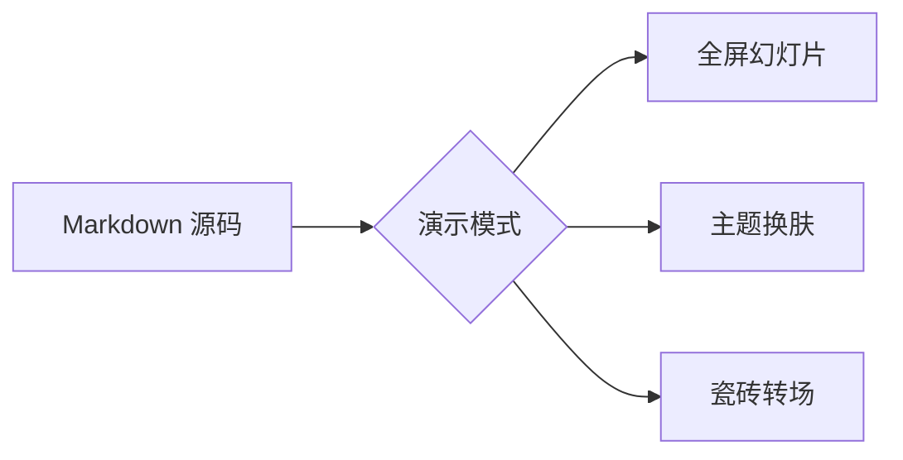

# 演示模式完全指南

把任意 Markdown 文档变成全屏幻灯片，不需要写任何版式标记。

这份文档既是**使用说明**，也是**示范**：它的每一页，都是该页 Markdown 结构自动推断出来的版式。

---

## 这份文档怎么用

按 `Ctrl+Alt+P`（或工具栏「放映」、标签栏「演示」）进入播放，`Esc` 退出。

每页末尾有一行灰色小字，标出**这一页为什么会是这个版式**。想抄哪种版式，把那一页的 Markdown 复制走就行。

播放中按 `?` 调出快捷键浮层，按 `S` 锁定提词备注（它默认收在屏幕左缘外）。

本文在 front matter 里开启了 `slideshow-fragments: on`，所以列表页会**逐条出现**，第 30 页讲怎么控制它。

*版式来源：标题 + 段落 ⇒ 内容页*

---

## 目录

1. 播放与控制
2. 版式：13 种，零标记
3. 分栏：一页分成多栏
4. 进阶控制与常见误区

---

## 一、播放与控制

---

## 快捷键速查

| 操作 | 按键 | 说明 |
|------|------|------|
| 下一页 | `→` `空格` `PageDown` `Enter` | 列表分段时先出下一条 |
| 上一页 | `←` `PageUp` `Backspace` | 分段时先收回上一条 |
| 首页 / 末页 | `Home` / `End` | |
| 全屏 | `F` | 退出演示时还原进入前的窗口状态 |
| 提词备注 | `S` | 该页写了备注时才显示（默认收在屏幕左缘外）|
| 帮助浮层 | `?` | 再按一次关闭 |
| 退出 | `Esc` | 先关浮层与面板，再退出演示 |

鼠标滚轮：内容**真正超出可视区**时先滚内容，滚到边界再翻页；内容已完整显示则直接翻页。

*版式来源：标题 + 表格 ⇒ 数据表页（表头主题色、偶数行斑马纹）*

---

<!-- fragments: off -->

## 播放中的 HUD

鼠标一动，右下角出现一排半透明图标：

- **列表图标** —— 片段逐步显示开关（仅本次播放生效）
- **星形图标** —— 翻页动画，12 种可选
- **调色盘** —— 切换主题与明暗（仅本次播放生效）
- **`Aa`** —— 排版面板，见第 32 页

左下角是章节名与页码，底部有一条随翻页增长的进度条。

*版式来源：标题 + 列表 ⇒ 列表页。本页写了 `<!-- fragments: off -->`，所以列表一次整页显示*

---

## 二、版式：13 种，零标记

---

## 版式是怎么定出来的

引擎会**扫描整页的块结构** —— 标题、段落、列表、表格、图片、代码、图表、公式 —— 再按注册表的优先级取第一个命中的版式。

判定看的是**整页**，不是只有首块：标题层级、块的组合、内容类型共同决定结果。

`---`（单独成行）先被吃掉用于**分页**，`***`（单独成行）用于**分栏**，两者都不参与版式判定。

HTML 注释指令在判定**之前**就被剥离，所以它们不会干扰自动推断。

*版式来源：标题 + 段落 ⇒ 内容页*

---

## 版式对照表（上）：仪式与结构

| 页面结构 | 版式 | 视觉效果 | 本文示例 |
|----------|------|----------|----------|
| `# 标题` + 副标题段落 | `cover` 封面页 | 居中巨号标题 + 渐变下划线 + 作者·日期 | 第 1 页 |
| `# 谢谢` / `Thanks` / `Q&A` | `thanks` 结尾页 | 居中收尾 + 渐变下划线 | 第 34 页 |
| `## 标题` 单独成页 | `section` 章节页 | 大号章节序号 + 居中标题 | 第 4 / 7 / 20 / 27 页 |
| `## 目录` + 有序列表 | `agenda` 目录页 | 大号数字 + 双列网格 | 第 3 页 |
| `>` 引用开头 | `quote` 金句页 | 对角大引号 + 居中大字 | 第 15 页 |

*版式来源：标题 + 表格 ⇒ 数据表页。「本文示例」的页码指本文档，自己增删页面后会漂移*

---

## 版式对照表（下）：内容型

| 页面结构 | 版式 | 视觉效果 | 本文示例 |
|----------|------|----------|----------|
| 标题 + 段落 | `content` 内容页 | 标题左上 + 强调下划线 | 第 2 页 |
| 标题 + 列表 | `content-list` 列表页 | 大号列表，可逐条显示 | 第 6 页 |
| 标题 + 表格 | `table` 数据表页 | 表头主题色 + 斑马纹 | 第 5 页 |
| 标题 + 任务列表 | `roadmap` 路线图页 | 大号勾选框，可逐条显示 | 第 12 页 |
| 图片开头（后面可跟文字） | `image` 图片页 | 图片居中，图与文纵向排列 | 第 14 页 |
| 标题 + 代码围栏 | `code` 代码页 | 代码聚焦 | 第 16 页 |
| 标题 + `mermaid` 围栏 | `chart` 图表页 | 图表居中 | 第 17 页 |
| 标题 + `$$` 公式 | `formula` 公式页 | 公式放大居中 | 第 18 页 |

> **图文并排不再自动产生**：旧版会把「图片 + 文字」变成左图右文双栏（`figure`），现在默认按书写顺序纵向排列、图片居中。想要并排请用 `***` 分栏；确实要旧版式可显式指定 `<!-- layout: figure -->`。

*版式来源：标题 + 表格 ⇒ 数据表页*

---

## 触发词是精确匹配的

结尾页与目录页靠**标题文字**触发，判定是整串相等，不是「包含」。

结尾页只认 `谢谢`、`感谢`、`Thanks`、`Thank you`、`Q&A`、`The End` —— 写成 `# 谢谢观看` **不会**命中，会一路回落成封面页。

目录页只认 `目录`、`大纲`、`Agenda`、`Contents`、`Table of Contents`、`TOC`，写成 `## 1. 目录` 同样不命中。

不确定时直接用指令指定版式，最省心（写法见第 28 页）。

*版式来源：标题 + 段落 ⇒ 内容页*

---

## 路线图页

- [x] 已完成：确认需求
- [x] 已完成：拆分页面
- [ ] 进行中：逐页打磨
- [ ] 待办：正式演示

任务列表（`- [ ]` 与 `- [x]`）会触发路线图版式，并与列表页一样支持片段逐步显示。

*版式来源：标题 + 任务列表 ⇒ 路线图页*

---

## 图片默认居中


这张图是**单独成块**的图片：无论页面上有没有标题，它都收缩到原生尺寸、在页面中间居中，不再被拉满整行贴在左边。
图与后面的说明文字按**书写顺序纵向排列**。想要左右并排（图左文右），用 `***` 分栏即可 —— 还能自由决定几栏、栏内对齐与卡片。
*版式来源：标题 + 图片 + 段落 ⇒ 内容页；图片居中由 `.ys-slide > img` 负责，与版式无关*

---


<!-- 本页结构：图片单独成页 ⇒ 图片页（图片居中）。只要图片是本页第一个块就会命中，后面跟不跟文字都一样 -->

---

> 好的演示，让想法自己说话

引用必须是**本页第一个块**才会触发金句页；如果前面先写了标题，它就只是普通内容页里的一个引用块。

*版式来源：`>` 开头 ⇒ 金句页*

---

## 代码页

标题之后紧跟代码围栏即可：

```js
const greeting = 'Hello, YiziMarkdown!'
console.log(greeting)
```

过长的**行内代码**会自动折行，不会被页面右边缘截断，折行处仍带完整背景与圆角：

`"{:=^20}".format("python")`

*版式来源：标题 + 代码围栏 ⇒ 代码页*

---

## 图表页



*版式来源：标题 + mermaid 围栏 ⇒ 图表页*

---

## 公式页

$$
\int_{-\infty}^{+\infty} e^{-x^2} \, dx = \sqrt{\pi}
$$

行内公式用单个 `$` 包裹即可，例如 $e^{i\pi} + 1 = 0$。

*版式来源：标题 + `$$` 块 ⇒ 公式页*

---

## 图表与公式需要先启用插件

Mermaid 与 KaTeX 是**插件**，默认关闭。首次打开这份文档时，图表页会显示成普通代码块、公式页会显示成普通文本。

在 **设置 → 插件** 里勾选 `mermaid` 与 `katex` 即可。注意**版式推断不依赖插件** —— 只要结构是「标题 + mermaid 围栏」，它就已经是图表页了，缺的只是内容渲染。

*版式来源：标题 + 段落 ⇒ 内容页*

---

## 三、分栏：一页分成多栏

---

## 分栏基础

用**单独成行的 `***`** 圈出栏区：首尾两条是**边界**，中间的是**分隔** —— 和表格的 `|` 一样，同一个记号靠位置决定身份。

***

- 左栏第一条
- 左栏第二条

***

- 右栏第一条
- 右栏第二条

***

`***` **之外**的内容是页级文案：引言在栏之上、落款在栏之下，都不参与分栏。

*版式来源：标题 + 引言 + 栏区 + 落款 ⇒ 列表页（跨栏的两个列表不会被合并成一个）*

---

## 三栏与四栏

一页最多 4 栏；超出时后续内容自动并入最后一栏（控制台会提示，**内容不丢**）。空栏，也就是连续两个 `***`，会被自动丢弃。

***

- 第一栏
  - 对比项 A

***

- 第二栏
  - 对比项 B

***

- 第三栏
  - 对比项 C

***

**N 栏写 N+1 条 `***`**。不放栏外文案时，也可以沿用老写法只写 N−1 条（首尾两条省去），两种写法都认。

*版式来源：分栏不单独指定版式，仍由整页结构判定；本页是标题 + 列表 ⇒ 列表页*

---

## 页标题不参与分栏

上面这个标题是**页标题**，整页显示在分栏之上，不会落进左栏。

***

- 左栏内容
- 起点与右栏齐平

***

- 右栏内容
- 起点与左栏齐平

***

想给**每一栏各写标题**：把页标题写在最前，再在它之后开始栏区；各栏内部的小标题照常生效。

*版式来源：页标题 = 页内第一个 `#` 至 `######` 标题，不计入任何一栏*

---

## 窄栏不会被撑破

栏内一旦出现宽内容（长 URL、长代码行、宽表格），该栏**不会撑破页面**，而是在栏内横向滚动。

***

https://example.com/a/very/long/url/that/would/otherwise/blur/out/the/column/layout/1234567890

***

```text
this_is_a_long_code_line_that_must_scroll_inside_its_own_column_instead_of_widening_the_grid
```

***

*版式来源：本页含代码围栏 ⇒ 代码页（代码页同样可以分栏）。要点是每栏最小宽度被压到 0，横向滚动才会发生在栏内*

---

## 栏内对齐与卡片

分栏是**等宽栅格**：第 2 栏的左边线恒等于「屏幕中心 + 栏间距的一半」，拖「内容填充宽度」时它**一动不动**。栏内容少的时候，会让人觉得右边没有反应。

播放中点 HUD 的 `Aa`，有两个专门针对分栏的旋钮：

- **栏内对齐** —— 左 / 中 / 右。栏内的标题、正文、列表、引用、图片、代码块一并对齐；
  **页标题不参与**，它继续跟所属版式走
- **分栏样式** —— **卡片（默认）** / 分隔线 / 无。卡片给每栏一个等高外框，
  随填充宽度**两侧同时伸缩**，分栏占位一目了然；分隔线则只在栏间画一条中缝细线

文档里写了 `<!-- align: center -->` 这条指令时，**该页以文档指令为准**，HUD 是全局默认。

*版式来源：两个旋钮只作用于分栏页，非分栏页完全不受影响*

---

## 分栏的边界情况

- `***` 同时是栏区**边界**与**分隔**（和表格的 `|` 一样）：首尾两条圈住栏区，之外的是页级文案
- 只写 1 条或 2 条 `***` 时按老写法读（2 栏 / 3 栏）—— 圈定读法在这两档会退化成「空栏区 / 单栏」，不可能是本意
- 代码围栏内部的 `***` 是**代码内容**，不参与计数，因此不会破坏圈定
- 行首有空格的 `***` 不切分，尾随空格可以；四个星号也不算
- `***` **不再渲染为分隔线** —— 页内需要分隔线请用 `___` 或 `- - -`
- 分栏页会**压过**图文页的左图右文栅格：图片 + 文字 + 分栏同时出现时，以分栏为准
- 预览模式下 `***` 仍是一条水平分割线，分栏是演示模式的专属行为

*版式来源：标题 + 列表 ⇒ 列表页*

---

## 四、进阶控制与常见误区

---

## 四种显式指令

都是 HTML 注释，渲染时**不可见**，也不影响预览。

| 指令 | 作用 |
|------|------|
| `<!-- layout: quote -->` | 强制指定版式，覆盖自动推断；非法值忽略并回落推断 |
| `<!-- align: center -->` | 整页对齐；分栏页上同时覆盖 HUD 的栏内对齐 |
| `<!-- fragments: off -->` | 该页不参与片段逐步显示 |
| `<!-- notes: 内容 -->` | 提词备注，按 `S` 锁定显示 |

`layout` 可用值共 14 个：`cover`、`section`、`thanks`、`agenda`、`content`、`content-list`、`table`、`roadmap`、`figure`、`image`、`quote`、`code`、`chart`、`formula`。
其中 `figure` **不会被自动推断命中**（自动路径只有 13 种），只能靠这条指令显式指定。

> **指令必须独占一行**：整行只有这条注释才算数，与 `---` 分页、`***` 分栏是同一个规矩。
> 写在正文里、代码块里、行内代码里、表格里都只是「提到」，**不会被执行，也不会被吃掉** ——
> 所以你完全可以像本页这样，把指令当教学内容写出来。多个指令各占一行。

*版式来源：标题 + 表格 ⇒ 数据表页。指令在版式推断之前被剥离，不会干扰自动判定*

---

<!-- notes: 这是提词备注。备注支持多行，冒号也可以省略。 -->

## 提词备注

备注写在 HTML 注释里。它**与幻灯片同屏显示**，观众看得到，所以默认收在屏幕左缘之外：

- 鼠标移到**屏幕左缘**（约 24px 宽的热区）→ 面板滑出，移开即收回
- 按 `S`（或 HUD 的「提词」按钮）→ **锁定常显**；再按一次或点「关闭」→ 收回
- 只有**当前页有备注**时，HUD 才会出现「提词」按钮
- 本页就有备注：把鼠标移到屏幕左缘，或直接按 `S`

> 它不像 PowerPoint / WPS 那样有副屏「演示者视图」。适用场景：第二块屏幕、平板放另一份文档，
> 或者你背对观众时自己看。

*版式来源：备注在分页之前被剥离，不影响本页的版式判定*

---

## 片段逐步显示

**内容页 / 列表页 / 路线图页**的顶层列表项可以逐条出现：按 `→` 先出下一条，全部出完再按才翻页；按 `←` 先收回一条。讲哪条，观众看哪条。

- 第一条：这个功能**默认关闭**，避免目录等内容被迫逐条点击
- 第二条：本文在 front matter 写了 `slideshow-fragments: on`，所以现在是开着的
- 第三条：也可以播放中点 HUD 的列表图标随时开关，仅本次播放生效
- 第四条：单页用 `<!-- fragments: off -->` 关掉。注意页级的 `on` 只是「允许」，真正的开关在整副演示级别，所以只写页级 `on` 不会生效

*版式来源：标题 + 列表 ⇒ 列表页；本页 4 条会逐条出现*

---

## front matter 可控项

文档最顶部那一对 `---` 包裹的区域是 front matter，演示模式会读这几个键。

`title` 是演示标题，HUD 与章节名显示它，没有才回落到文档名。`author` 与 `date` 用于封面页底部的 meta 行。`slideshow-fragments: on` 让整副演示默认开启片段逐步显示。

front matter 本身**不会**成为一页幻灯片。

*版式来源：标题 + 段落 ⇒ 内容页*

---

## 排版、动画与主题

播放中点 HUD 右下角的三个图标：

- **翻页动画** —— 12 种。柔和型：水平滑动（默认）、淡入淡出、轻微缩放、无；
  强烈型：卡片推换、高斯溶解、百叶窗格、棋盘格子、百变立方、六角蜂巢、爆裂卡片、纵深穿梭
- **调色盘** —— 进入演示时继承当前主题与明暗，播放中可临时切换，仅本次播放生效
- **`Aa` 排版面板** —— 字体（跟随主题 / 无衬线 / 衬线 / 等宽）、字重 300~700、字号 70%~160%、
  内容填充宽度与高度 50%~95%、栏内对齐、分栏样式，底部有「恢复默认」

排版面板的改动会**持久化**，下次进入演示沿用；动画与主题只影响本次播放。

「内容填充宽度 / 高度」是内容区占整屏的比例，也是**唯一**的宽度依据 —— 窗口很宽时正文行太长，把它调小（如 55%）即可。

*版式来源：标题 + 列表 ⇒ 列表页*

---

## 常见误区

- `---` 是**分页**，`***` 是**分栏**，两者都是标准分割线，别混用
- `***` 必须单独成行，**N 栏写 N+1 条**（首尾两条是栏区边界）；只写 1 或 2 条时按老写法读（2 栏 / 3 栏），存量文档不受影响
- 最多 4 栏，超出并入最后一栏 —— 注意 **3 条 `***` 会被读成「2 栏 + 栏外文案」**，不是 4 栏
- 结尾页标题要**恰好**是 `谢谢` 或 `Thanks` 这类词，`谢谢观看` 会变成封面页
- `<!-- fragments: on -->` 不会单独打开分段，真正的开关在 front matter 或 HUD
- 图表页 / 公式页需要先在 设置 → 插件 里启用 `mermaid` 与 `katex`
- 版式推断只认**块结构**：表格没顶格写 `|`、列表标记写在段落中间，都会判定失败

*版式来源：标题 + 列表 ⇒ 列表页*

---

# 谢谢

按 `Esc` 退出演示，回到编辑界面。

这份文档的每一页都可以直接抄走 —— 结构就是版式。
